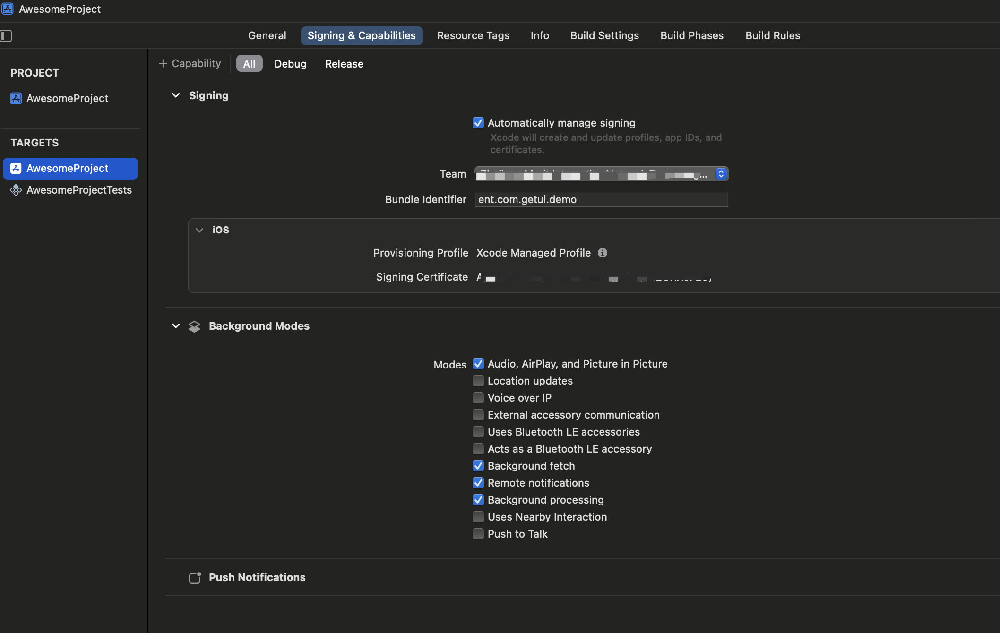
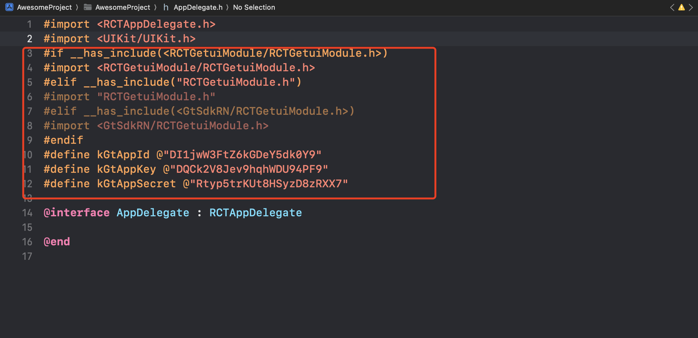
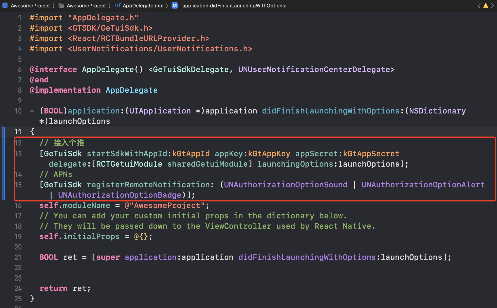

# react-native-getui 
* react-native-getui 是个推官方开发的 React Native 插件，使用该插件可以方便快速地集成推送功能。
* 多厂商版本请联系技术支持
* ohos单独看[README.md](react-native-harmony-push/README.md)


# 环境

当前发布版本为 `react-native-getui@1.1.56`。AndroidDemo 已在以下环境完成构建、安装和推送初始化验证：

```json
{
  "react": "19.1.1",
  "react-native": "0.82.1"
}
```

注意：
- React Native `>= 0.76` 建议使用插件 `>= 1.1.54`。
- `1.1.53` 为 Expo App 定制版本。


# 1.安装


### 1.1 使用 npm 自动安装

在您的项目根目录下执行

```bash
# 安装已验证的 1.1.56 版本
npm install react-native-getui@1.1.56 --save

# iOS CocoaPods 项目
npx pod-install
```

如需使用后续版本，可将 `@1.1.56` 替换为 `@latest`，并重新验证项目构建和推送初始化。

React Native `0.60+` 默认使用 Autolinking，无需执行 `react-native link`。仅旧版非 Autolinking 项目按 [Android 手动集成文档](document/android.md) 配置原生工程。

旧版项目可使用以下脚本写入历史 `PUSH_*` 配置：

```bash
npm run GetuiConfigure <yourAppId> <yourAppKey> <yourAppSecret> <yourModuleName>
```

`yourModuleName` 是 Android 模块名称；iOS 不受此参数影响，默认值为 `app`。现代 React Native Android 项目请采用 [Android 手动集成文档](document/android.md) 中的 `GETUI_APPID` 配置，不建议运行该旧脚本修改 Gradle 文件。

## 1.2 示例

* 新版本插件 [AndroidDemo](https://github.com/GetuiLaboratory/react-native-getui/tree/master/example/AndroidDemo)，本地运行步骤见 [example/AndroidDemo/README.md](example/AndroidDemo/README.md)

* iOS 最新[参考Demo](https://github.com/GetuiLaboratory/react-native-getui/tree/master/example/IosDemo)


# 2. 配置

* yourAppId  yourAppKey   yourAppSecret  需要去 [个推官网](https://dev.getui.com) 注册后，在后台配置获取。


## 2.1 Android

* 从 1.1.56 版本开始，Android 个推 SDK 使用 Maven 依赖：
  * `com.getui:gtsdk:3.3.15.0`
  * `com.getui:gtc:3.3.3.0`
* 如果主工程统一管理 Maven 仓库，请添加个推仓库：

  ```gradle
  maven {
      url "https://mvn.getui.com/nexus/content/repositories/releases/"
  }
  ```

* React Native `0.60+` 的 Android 项目使用 Autolinking。在 `android/app/src/main/AndroidManifest.xml` 的 `<application>` 中配置 AppID：

  ```xml
  <manifest>
   <application>
      <meta-data android:name="GETUI_APPID" android:value="你的 AppID" />
     </application>
  </manifest>
  ```

  `1.1.56` AndroidDemo 已使用此配置成功初始化并获取 CID。旧项目如继续使用 `GetuiConfigure` 脚本，会生成 `PUSH_APPID`、`PUSH_APPKEY` 和 `PUSH_APPSECRET` 历史配置。

* 默认不混淆, 如果开启了混淆
  将插件中proguard.txt的内容, 复制到Android工程的proguard-rules.pro中
  ```txt
    -keep class com.igexin.** { *; }
    -keep class com.getui.gtc.** {*;}
    //如果接入厂商,查看proguard.txt
  ```


## 2.2 IOS

### 2.2.1 使用step3: 自动添加GTSDK配置代码后,

* Appdelegate.h 自动生成配置

  ```objective-c
  #if __has_include(<RCTGetuiModule/RCTGetuiModule.h>)
  #import <RCTGetuiModule/RCTGetuiModule.h>
  #elif __has_include("RCTGetuiModule.h")
  #import "RCTGetuiModule.h"
  #elif __has_include(<GtSdkRN/RCTGetuiModule.h>)
  #import <GtSdkRN/RCTGetuiModule.h>
  #endif
  #define kGtAppId @"DI1jwW3FtZ6kGDeY5dk0Y9"
  #define kGtAppKey @"DQCk2V8Jev9hqhWDU94PF9"
  #define kGtAppSecret @"Rtyp5trKUt8HSyzD8zRXX7"
  ```

* Appdelegate.m 的didFinishLaunchingWithOptions中自动生成代码

  ```objective-c
   // 接入个推
  [GeTuiSdk startSdkWithAppId:kGtAppId appKey:kGtAppKey appSecret:kGtAppSecret delegate:[RCTGetuiModule sharedGetuiModule] launchingOptions:launchOptions];
  
   // APNs
  [GeTuiSdk registerRemoteNotification: (UNAuthorizationOptionSound | UNAuthorizationOptionAlert | UNAuthorizationOptionBadge)];  
  ```

没有的话, 需要自己添加


### 2.2.2 使用CocoaPods安装 

如果是原生应用集成react-native

如果你的 React Native 是通过 Cocoapods 来集成的则使用下面两个步骤来集成 

1. 在Podfile中添加如下代码（需要写在对应的 target 里）：

````
pod 'GtSdkRN', :path => '../node_modules/react-native-getui'
````

2. 终端执行如下命令：

````
pod install
````

**注意:** 

*  使用 pod 就不要使用 react-native link 了，不然会有冲突。

* 在 iOS 工程中如果找不到头文件可能要在 TARGETS-> BUILD SETTINGS -> Search Paths -> Header Search Paths 添加如下如路径

  ```
  $(SRCROOT)/../node_modules/react-native-getui/ios/RCTGetuiModule
  ```

  

### 2.2.3 手动安装

 替换 step3: 自动添加GTSDK配置代码手动安装

* [Xcode 工程配置](https://github.com/GetuiLaboratory/react-native-getui/blob/master/document/iOS.md)
* [Android Studio 工程配置](https://github.com/GetuiLaboratory/react-native-getui/blob/master/document/android.md)

**注意:** 

* 在 iOS 工程中如果找不到头文件需要在 TARGETS-> BUILD SETTINGS -> Search Paths -> Header Search Paths 添加如下如路径：

  ```
  $(SRCROOT)/../node_modules/react-native-getui/ios/RCTGetuiModule
  ```

* 因新版本功能修改，需要添加“libresolv.tbd”库


## 2.3 Ohos

查看文档 [README.md](react-native-harmony-push/README.md)


## 2.4 API调用与订阅消息


查看示例

android 与 ios 有部分API不同, 查看插件的index.js 或 index.d.ts中API的注释


# 3.iOS注意事项

项目需要打开通知能力，才能获取DeviceToken用于通知展示点击等业务。Xcode打开工程,Signing & Capabilities中添加Push Notification和Background Modes如下：



上述GetuiConfigure指令会在AppDelegate中插入初始化GTSDK代码，具体如下：




